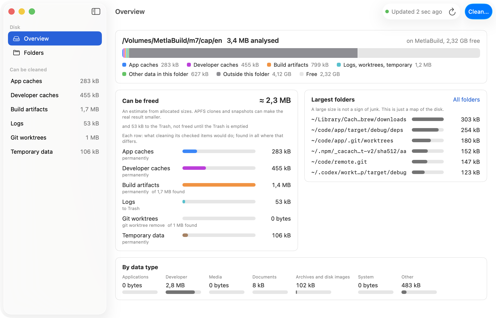
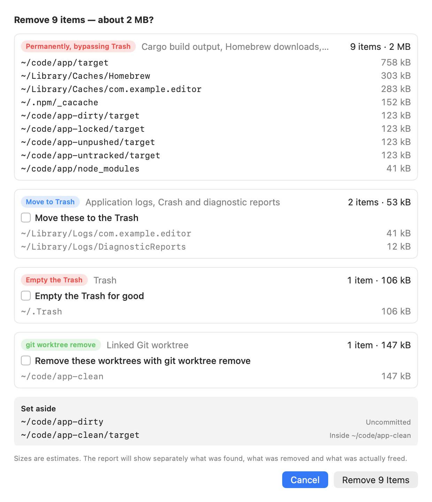
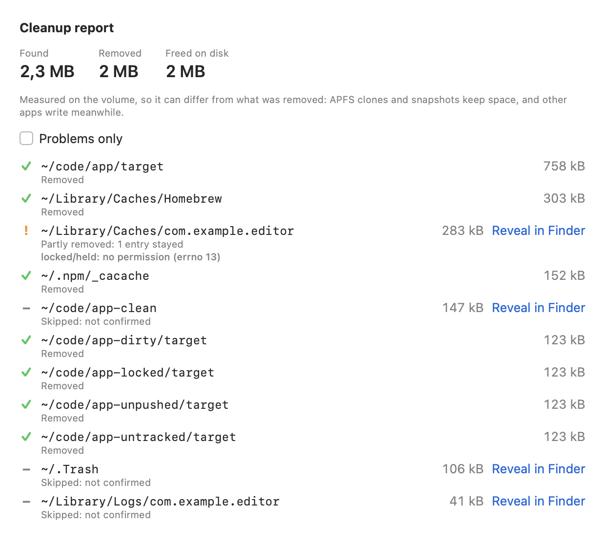
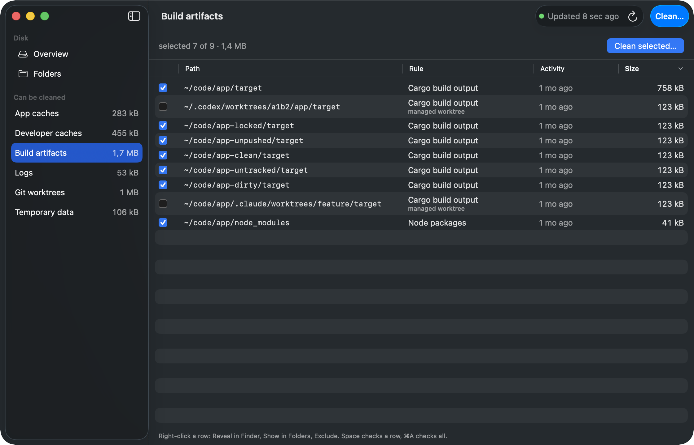
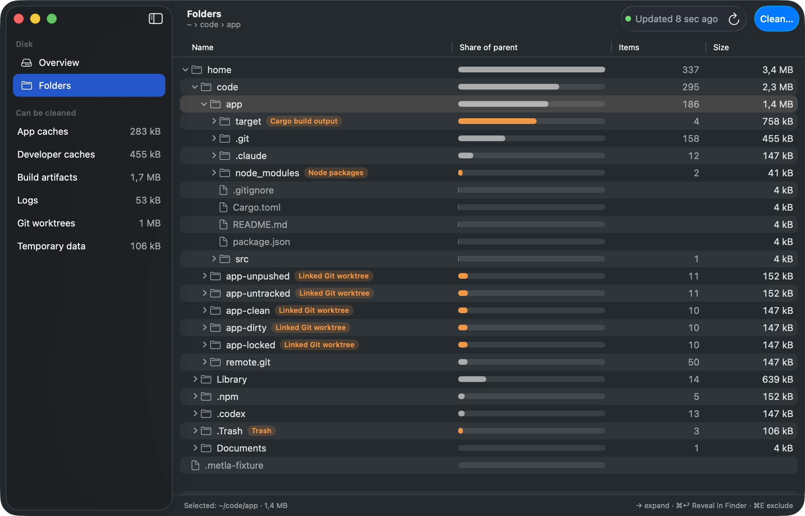
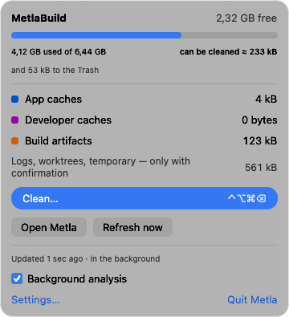
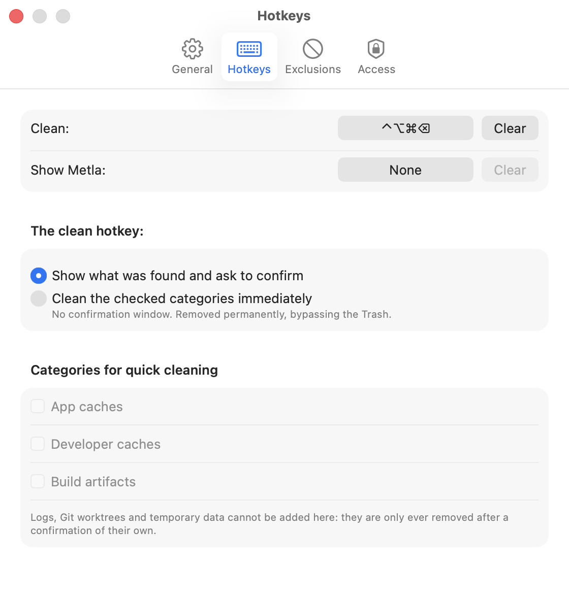

# Metla

A free, open-source SSD cleaner for macOS. *Metla* is Russian for "broom".

Metla shows what occupies your disk — by category and by folder, down to
individual files — and removes only what is verifiably disposable:
application and developer-tool caches, build output inside Git
repositories, logs, the Trash and stale Git worktrees.



**What it is**

* A map of the disk that stays fresh: one full scan of metadata, then
  FSEvents tell it what changed, so the picture is current without
  rescanning everything.
* A cleaner with a short, fixed list of rules. Every candidate comes from
  a named rule with a marker it can verify ([docs/RULES.md](docs/RULES.md));
  a folder is never junk because it is big.
* A native app: a main window, a menu-bar panel and a global hotkey, in
  English and Russian, light and dark. A Rust core does the scanning,
  classification and removal; SwiftUI and AppKit show it.

**What it is not**

* Not an "optimizer": no memory purging, no system caches, nothing under
  `/System`, nothing that needs root.
* Not a duplicate finder or a large-file janitor. Large folders are shown
  so you can decide; Metla offers nothing because of its size.
* Not a background service that deletes on a schedule. Nothing is removed
  unless you confirm it, or you opt in to a hotkey that cleans caches and
  build output only.

## Screens

| | |
|---|---|
|  |  |
|  |  |
|  |  |

The pictures come from the app's own capture mode on a synthetic fixture
(`scripts/run-app.sh --capture <dir>`), named as it names them.

## What it cleans

Six categories, each removed the way that fits it ([docs/RULES.md](docs/RULES.md)
lists every rule, its marker and whether it keeps the directory itself):

| Category | Examples | How it goes | Quick clean |
|---|---|---|---|
| App caches | `~/Library/Caches/<app>`, browser and Electron caches | deleted, the empty folder kept | possible (opt-in) |
| Developer caches | Homebrew, npm, pnpm, pip, Cargo registry, Go, Gradle, Xcode DerivedData | deleted | possible (opt-in) |
| Build artifacts | `target`, `node_modules`, `.build`, `__pycache__` … next to their project file, inside a Git repository, ignored by Git | deleted | possible (opt-in) |
| Logs | `~/Library/Logs/*`, crash reports | moved to the Trash | never |
| Temporary data | the Trash | emptied | never |
| Git worktrees | linked worktrees that are clean, pushed, unlocked and not in use | `git worktree remove` | never |

Recently changed build output (14 days by default) and every worktree are
listed but not preselected. Folders you exclude are never offered again.

## What it never does

* Never asks for root and never uses `sudo`; never works around macOS
  privacy protection (TCC): without Full Disk Access protected folders
  are skipped and the picture says it is partial.
* Never removes a Git worktree by force, never one with uncommitted,
  untracked or unpushed work, a lock, an operation in progress or recent
  activity.
* Never removes a worktree that Codex or Claude Code manage
  (`~/.codex/worktrees`, `…/.claude/worktrees`); their build output is
  offered only when you confirm each item by itself.
* Never follows a symbolic link, never crosses into another volume, never
  reads a file's contents (two tiny marker files excepted: a `.git`
  pointer and `CACHEDIR.TAG`), never triggers a cloud download.
* Never talks to the network, except to check for updates: one request
  to GitHub at launch and once a day, which you can turn off
  ([Updates](#updates)).

## Safety model

1. Allow-list only: a directory is a candidate when a named rule and its
   marker match; anything else stays.
2. Build output must be inside a Git repository and ignored by Git, with
   nothing tracked inside; Git is asked after each scan and again right
   before removal.
3. Every item is checked again right before it is touched: same device and
   inode, reached without a symlink, rule still matching, not excluded —
   or it is skipped and nothing changes.
4. Removal opens each directory relative to its parent and unlinks
   entries; it never chmods, never follows links, stops at other volumes.
5. You see the exact list, grouped by how it is removed, before anything
   happens; logs, the Trash and worktrees need a confirmation of their own.
6. The quick-clean hotkey is limited by type to caches and build output.
7. Found, removed and freed are three numbers: freed is the measured change
   in free space, never a promise.
8. Running a cleanup twice ends in the same state.
9. Development builds cannot clean anything but a synthetic fixture marked
   `.metla-fixture`; only the release app's build can.
10. Everything is in this repository; the gates are in
   [docs/QUALITY.md](docs/QUALITY.md).

## Build and run

Requirements: macOS 14 or later (developed on macOS 26 on Apple
Silicon), Xcode with Swift 6.2 or later (developed with 6.3), Rust stable
1.85 or later through `rustup` (developed with 1.92), and for the
optional architecture view the Clojure CLI and
[uml-viewer](https://github.com/unclebob/uml-viewer).

```
scripts/build-core.sh               # the Rust core for the app, and the Swift bindings
scripts/build-app.sh --debug        # the debug app: it cleans synthetic fixtures only
scripts/run-app.sh                  # starts it on a fixture metla-cli makes
scripts/build-app.sh --release      # Metla.app and Metla.zip: can clean your disk
```

The bundles land under `target/app/`, built for the machine's own
architecture. Every build links the core it has just built: the core
carries a stamp (a hash of its sources), `build-app.sh` refuses to bundle
an executable without it, and the app prints it in its first line on
stderr (`metla 0.7.3, core <stamp>`). A build is signed ad-hoc unless
`METLA_SIGN_IDENTITY` names a certificate (see Full Disk Access below).
Published releases up to 0.7.2 are ad-hoc signed; later ones are signed
with the maintainer's Apple Development certificate. Neither kind is a
Developer ID signature, and nothing is notarised: a copy you build
yourself opens normally; a downloaded one is quarantined and has to be
allowed once, in System Settings → Privacy & Security → Open Anyway.
Start a development build with `METLA_ROOT` pointing at a fixture
(`run-app.sh` does); `scripts/run-scenarios.sh` drives the cleanup flows
and the update end to end. [CONTRIBUTING.md](CONTRIBUTING.md) has the gates and the development rules.

The icon is `app/Icon/AppIcon.icns`, committed; `scripts/make-icon.sh`
draws it again from the shapes in `scripts/make-icon.swift`, every size
at its own pixels, after a change to the drawing.

## Full Disk Access

Without it macOS keeps Mail, Messages, Safari and other apps' data from
any app, Metla included: those folders are skipped and counted, and the
picture is marked partial. Settings → Access shows what Metla sees (it
checks by listing a few protected folders: at launch, whenever the app
becomes active, and after each full scan), opens the right System
Settings pane, and checks again. Metla may need a restart after access is
granted.

Some system folders stay closed even with Full Disk Access: those only
root may read (mode 700) and those the system itself protects (such as
Spotlight's index and data vaults). No app can read them whatever the
setting, so they are not counted. With access granted, the Overview says
how many in a quiet line under the disk's legend instead of the partial
banner, and nothing asks you to grant access for them. A picture made
before you granted access is scanned again once, by itself.

macOS ties the grant to the app's signature. An ad-hoc signature changes
with every build: each ad-hoc build is a new app to macOS, and the grant
is lost. A certificate's signature does not change from one build to
the next. Releases after 0.7.2 are signed with the maintainer's Apple
Development certificate, with a secure timestamp: the grant survives an
update from one of them to the next. Give it once more when you update
from 0.7.2 or earlier, and when you switch between a release and a copy
built from source. That certificate is a development one: it expires
and is replaced about once a year, and what a renewed certificate does
to the grant has not been checked.

A build from source is ad-hoc signed. To keep the grant across your own
rebuilds, sign with a certificate of your keychain
(`METLA_SIGN_IDENTITY=<identity> scripts/build-app.sh --release`; the
timestamp needs the network). The signature shows the certificate's
name to anyone who inspects the app.

## Updates

At every launch and once a day while it runs, Metla asks GitHub for the
latest release of this repository: one `GET` of
`https://api.github.com/repos/IlyaShorin/metla/releases/latest`. It
sends `User-Agent: Metla/<version>`, `Accept:
application/vnd.github+json` and `Accept-Language: en` (fixed, so your
languages are not sent); the system adds `Accept-Encoding`, `Connection`
and `Cache-Control: no-cache`. No identifier, no cookie, nothing else:
the session keeps no cookies, cache or credentials. GitHub sees your IP
address, that version and the time. Turn it off in Settings → General
("Check for updates automatically"); "Check Now" there and "Check for
Updates…" in the app menu still ask when you do. A failed automatic check
says nothing.

When a newer release (`v<a>.<b>.<c>`, not a draft or prerelease) has a
`Metla.zip`, the sidebar's foot and the menu-bar panel say so. Install
downloads it from GitHub (the same headers, without `Accept`; at most
100 MB, checked against the size and SHA-256 GitHub lists), unpacks it,
and installs it only if it is signed by the same certificate as the
running copy: it must satisfy the running app's own designated
requirement, the rule macOS ties Full Disk Access to, so an accepted
update keeps the grant. Its identifier must be Metla's and its version
and build higher than the running one's. Only then is the old copy
replaced (renamed aside, the new one renamed into place, the old one
put back if that fails, then removed), and Metla starts again. Nothing
is installed during a cleanup. A copy built from source (signed ad-hoc),
one macOS runs from a temporary place, one on a read-only volume or in a
folder you cannot write to only links to the release page. No helper,
no administrator password, no background install: you press Install each
time. The release notes are not shown in the app; "What's New" opens
the release's page on GitHub.

## Hotkeys

* **Clean** (⌃⌥⌘⌫ by default): shows what was found and asks to confirm.
  If you switch it to "clean immediately" (Settings → Hotkeys, confirmed
  by a separate dialog), it quick-cleans the categories you checked —
  only app caches, developer caches and build artifacts can be — and shows
  a small panel with found, removed and freed.
* **Show Metla**: unassigned until you choose one.

Hotkeys use Carbon's `RegisterEventHotKey`, which needs no Accessibility
permission.

## Known limitations

The full list, each with its consequence, is
[docs/LIMITATIONS.md](docs/LIMITATIONS.md). In short: no Developer ID
and not notarised (a downloaded copy has to be allowed once); built for
one architecture; freed space is measured, not promised
(APFS clones, snapshots and purgeable space); sizes are allocated-size
estimates; an update installs itself only into a copy signed by the same
certificate, and was not yet seen to do so between two published
releases; the Swift half is not covered by the mutation and complexity
tools; a real hotkey press, the login item and the Full Disk Access
pane were not verified by an automated run.

## Documents

[Architecture](docs/ARCHITECTURE.md) ·
[Glossary](docs/GLOSSARY.md) ·
[Rules](docs/RULES.md) ·
[Interface](docs/UI.md) ·
[Performance](docs/PERFORMANCE.md) ·
[Quality](docs/QUALITY.md) ·
[Limitations](docs/LIMITATIONS.md)

## License

MIT
